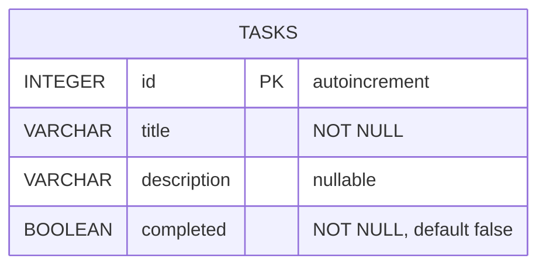

# Entity Relationship Diagram — Current Sprint: Sprint 4

> **Living document.** Updated when the data model changes. See `docs/checkpoints/` for snapshots.  
> **Last updated:** S4_2

> **S4_2:** `DatabaseTaskRepository` is implemented using SQLAlchemy. The ERD below
> now reflects a real database table defined by `SQLAlchemyTask` in
> `app/models/sqlalchemy_task.py`. Before S4_2 this diagram described the shape of
> the `tasks.json` file; the entity is the same, the storage is now a SQLite table.

---

## Diagram

---

## tasks table (SQLite via SQLAlchemy)

| Column | Type | Constraints | Notes |
|--------|------|------------|-------|
| id | INTEGER | PRIMARY KEY, AUTOINCREMENT | Auto-assigned |
| title | VARCHAR | NOT NULL | Required — validated in UI and service |
| description | VARCHAR | nullable | Optional |
| completed | BOOLEAN | NOT NULL, DEFAULT FALSE | Set by `complete_task()` |

### Notes
- Single table — no foreign keys in Sprint 4
- Database file: `tasks.db` (production), `:memory:` (tests)
- ORM: SQLAlchemy — table created via `Base.metadata.create_all(engine)`
- Model class: `SQLAlchemyTask` (`Mapped` / `mapped_column`); `to_dict()` returns the same shape as `Task.to_dict()` so `TaskService` and the routes are unchanged

---

## Storage History

| Sprint | Storage | Defined by |
|--------|---------|------------|
| S1–S3 | `tasks.json` (list of task dicts) | `Task` dataclass — `app/models/task.py` |
| S4_1 | `tasks.json` via `FileTaskRepository` | `Task` dataclass behind `ITaskRepository` |
| S4_2 | SQLite `tasks.db` via `DatabaseTaskRepository` | `SQLAlchemyTask` — `app/models/sqlalchemy_task.py` |
